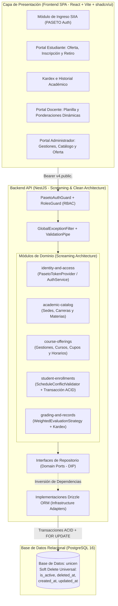

# SIIA UNICEN 2026 — Sistema Integrado de Información Académica

> **Universidad Central (UNICEN) • Sede Central Cochabamba, Bolivia**  
> *"Comprometida con tu Futuro Laboral"* — Campus Torre Empresarial (Calle Santivañez) & Campus Salud (Av. Juan de la Rosa).

Sistema académico empresarial Full-Stack desarrollado con **NestJS + Drizzle ORM (PostgreSQL)** en el Backend, autenticación mediante **PASETO v4.public (Ed25519)** y **React + TypeScript + Tailwind CSS + shadcn/ui** en el Frontend, diseñado bajo **Screaming Architecture**, **Clean Architecture** y principios **SOLID**.

---

## 1. Diagrama de Arquitectura del Sistema



---

## 2. Decisiones de Arquitectura

### A. Screaming Architecture + Clean Architecture
En lugar de organizar el proyecto en carpetas técnicas genéricas (`controllers/`, `services/`, `models/`), la estructura del código **grita el dominio académico universitario**:
- `modules/identity-and-access/`: Autenticación PASETO, control de roles (`ADMINISTRADOR`, `DOCENTE`, `ESTUDIANTE`) y padrón institucional.
- `modules/academic-catalog/`: Sedes oficiales de UNICEN, carreras de licenciatura y catálogo de materias.
- `modules/course-offerings/`: Gestiones académicas (con apertura/cierre de inscripciones), oferta de cursos, cupos y bloques de horarios.
- `modules/student-enrollments/`: Proceso transaccional de inscripción estudiantil, retiro con liberación de cupo y validador matemático de choques de horario.
- `modules/grading-and-records/`: Evaluaciones dinámicas con ponderación configurable (suma 100%), registro de calificaciones y generación del Kardex académico.

Dentro de cada módulo se separan estrictamente las tres capas de **Clean Architecture**:
1. **`domain/`**: Interfaces de repositorio, entidades y servicios de dominio puro (sin dependencias de frameworks ni de SQL).
2. **`application/`**: Casos de uso y DTOs validados perimetralmente con `class-validator`.
3. **`infrastructure/`**: Controladores HTTP, guardias de seguridad e implementaciones concretas de persistencia con **Drizzle ORM**.

### B. Eliminación Lógica Universal (Soft Delete) y Trazabilidad
En un sistema universitario real, eliminar físicamente (`DELETE FROM`) un curso, materia o inscripción destruye la integridad histórica de actas y kardex. Por ello, **las 10 tablas del esquema** incorporan el mixin transversal `auditAndSoftDeleteColumns`:
- `is_active` (`boolean`, `default true`)
- `deleted_at` (`timestamp`, nullable)
- `created_at` y `updated_at` (`timestamp`)
- Al retirar una inscripción (`DELETE /api/enrollments/:id`), se aplica baja lógica (`status = 'RETIRADA'`, `is_active = false`, `deleted_at = NOW()`) y se libera atómicamente el cupo en el curso.

---

## 3. Justificación de los Patrones de Diseño Elegidos

| Patrón de Diseño | Ubicación en el Código | Problema Resuelto y Justificación (*Por qué y Para qué*) |
| :--- | :--- | :--- |
| **Repository Pattern + Dependency Inversion (DIP)** | `domain/*.repository.interface.ts`<br>`infrastructure/drizzle-*.repository.ts` | **Por qué:** Acoplar los servicios de negocio a consultas SQL/ORM impide probar las reglas de dominio de forma aislada.<br>**Para qué:** Los casos de uso dependen de contratos abstractos (`IEnrollmentRepository`, `IGradingRepository`) inyectados por token IoC, centralizando el filtrado obligatorio de baja lógica (`isActive = true AND deletedAt IS NULL`). |
| **Strategy Pattern (OCP)** | `grading-and-records/domain/evaluation-strategy.interface.ts`<br>`weighted-evaluation.strategy.ts` | **Por qué:** Los reglamentos universitarios de evaluación pueden variar (evaluación continua ponderada, cursos intensivos, internado rotatorio).<br>**Para qué:** `WeightedEvaluationStrategy` encapsula el cálculo de nota ponderada sobre 100 puntos y determina automáticamente el estado (`APROBADA >= 51`, `REPROBADA < 51` o `ACTIVA`), cumpliendo el principio *Open/Closed (OCP)*. |
| **Adapter Pattern Criptográfico (PASETO v4.public)** | `identity-and-access/domain/token-provider.interface.ts`<br>`paseto-token.provider.ts` | **Por qué:** El enunciado solicita control de acceso PASETO/JWT por rol. PASETO (*Platform-Agnostic Security Tokens*) elimina vulnerabilidades de falsificación de cabecera de JWT (`alg: none`).<br>**Para qué:** Firmar y verificar tokens asimétricos `v4.public.` con curva elíptica **Ed25519** y codificación PAE oficial sin exponer detalles criptográficos a la capa de aplicación. |
| **Unit of Work / Pessimistic Locking (`FOR UPDATE`)** | `student-enrollments/infrastructure/drizzle-enrollment.repository.ts` | **Por qué:** Cuando decenas de estudiantes intentan tomar el último cupo de un curso al mismo tiempo, una lectura convencional produce sobrecupo (*race condition*).<br>**Para qué:** Ejecutar la validación de período abierto, no duplicidad, cupo disponible, choque de horario y el incremento de `enrolled_count` dentro de una transacción ACID con bloqueo de fila `SELECT ... FOR UPDATE`. |
| **Pure Domain Service** | `student-enrollments/domain/schedule-conflict.validator.ts` | **Por qué:** La verificación de solapamiento horario (`inicioA < finB && finA > inicioB` en el mismo día) es una regla matemática pura.<br>**Para qué:** Mantener la regla libre de infraestructura y verificarla con pruebas unitarias ultrarrápidas (`domain-logic.spec.ts`). |

---

## 4. Credenciales Institucionales de Prueba (Seeder UNICEN — Sede Cochabamba)

El seeder carga la **Sede Central Cochabamba** (`CBBA-CENTRAL`), las carreras oficiales de licenciatura en Cochabamba (*Lic. en Innovación Digital e IA, Medicina, Administración de Empresas, Fisioterapia y Kinesiología*), materias, horarios y calificaciones.

> **Contraseña universal para todas las cuentas de prueba:** `Unicen2026!`  
> *(En la pantalla de Login también dispones de botones de acceso rápido en 1 clic).*

| Rol | Correo Institucional | Nombre y Registro SIIA | Escenario de Prueba Preparado |
| :--- | :--- | :--- | :--- |
| **ESTUDIANTE** | `estudiante1@unicen.edu.bo` | **Alejandro Morales Camacho**<br>`RU-2026-482910` (Innovación Digital e IA - CBBA) | • Tiene 1 materia aprobada en `II-2025` (86.25 pts) visible en Kardex.<br>• Está inscrito en *Arquitectura de Software (`IIA-201`)* en `I-2026` (Lun/Mié 08:00-10:00).<br>• Puede inscribirse en *Ingeniería de Datos (`IIA-301`)* (sin choque).<br>• Puede probar **Choque de Horario** intentando inscribirse a *Redes Neuronales (`IIA-402`)* (Lun 08:30-10:30).<br>• Puede probar **Cupo Agotado** intentando inscribirse a *Anatomía Humana (`MED-101`)* (Cupo 2/2). |
| **DOCENTE** | `docente.ia@unicen.edu.bo` | **Ph.D. Ing. Roberto Méndez**<br>`DOC-IIA-104` (Sede Cochabamba) | • Titular de los cursos de IA y Arquitectura de Software.<br>• Puede configurar las ponderaciones dinámicas (%) y registrar notas parciales y finales por estudiante. |
| **ADMINISTRADOR** | `admin@unicen.edu.bo` | **M.Sc. Ricardo Quiroga Rojas**<br>`ADM-CBBA-001` (Sede Cochabamba) | • Abrir/cerrar inscripciones de las gestiones `I-2026` y `II-2025`.<br>• Crear y dar de baja lógica materias, cursos ofertados y usuarios, además de consultar Kardex estudiantil. |

---

## 5. Instrucciones de Despliegue y Ejecución

### Opción A: Ejecución Completa con Docker Compose (Recomendado para Evaluación)
Levanta automáticamente PostgreSQL 16 (`db`), ejecuta las migraciones y el seeder institucional en la API NestJS (`api`) y sirve la aplicación web en Nginx (`web`):

```bash
docker compose up --build
```

- **Portal Web SIIA UNICEN:** `http://localhost:5173` (también disponible en `http://localhost:8080`)
- **Backend API & Healthcheck:** `http://localhost:3000/api/health`
- **Base de Datos PostgreSQL:** `localhost:5432` (`unicen` / usuario `postgres` / clave `123456`)

---

### Opción B: Ejecución en Entorno Local (con `pnpm`)

1. **Base de Datos y Backend (`backend/`):**
   ```bash
   cd backend
   pnpm install
   pnpm exec drizzle-kit push --force
   pnpm run seed
   pnpm test
   pnpm run start:dev
   ```

2. **Frontend (`frontend/`):**
   ```bash
   cd frontend
   pnpm install
   pnpm run dev
   ```
   Abrir en el navegador: `http://localhost:5173`
